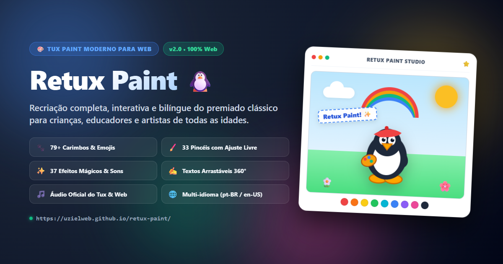
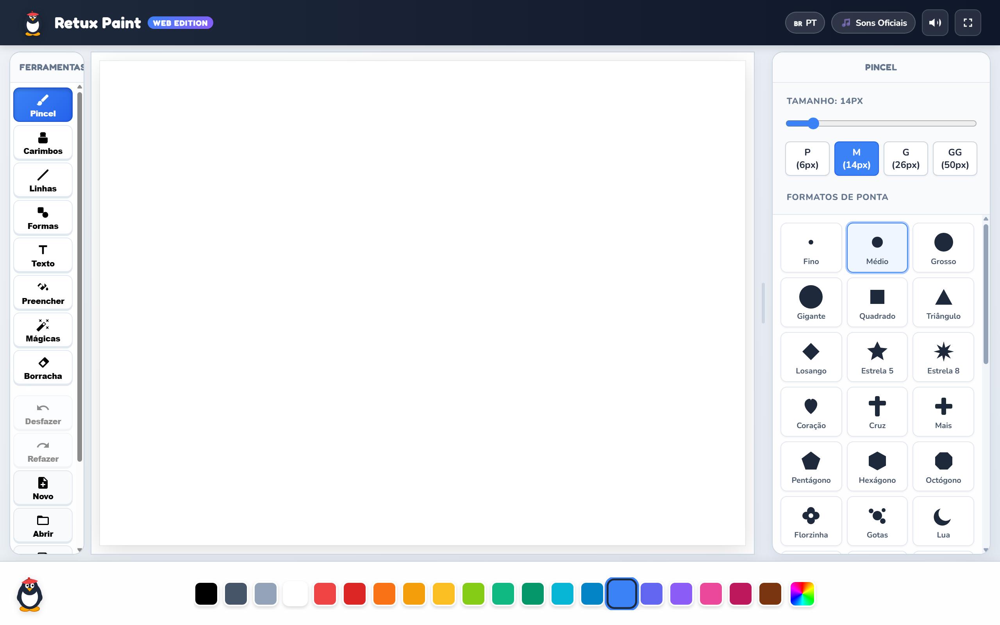
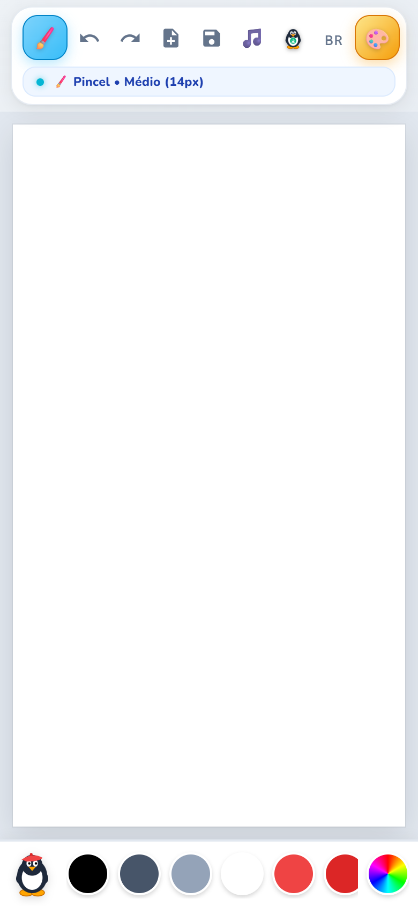
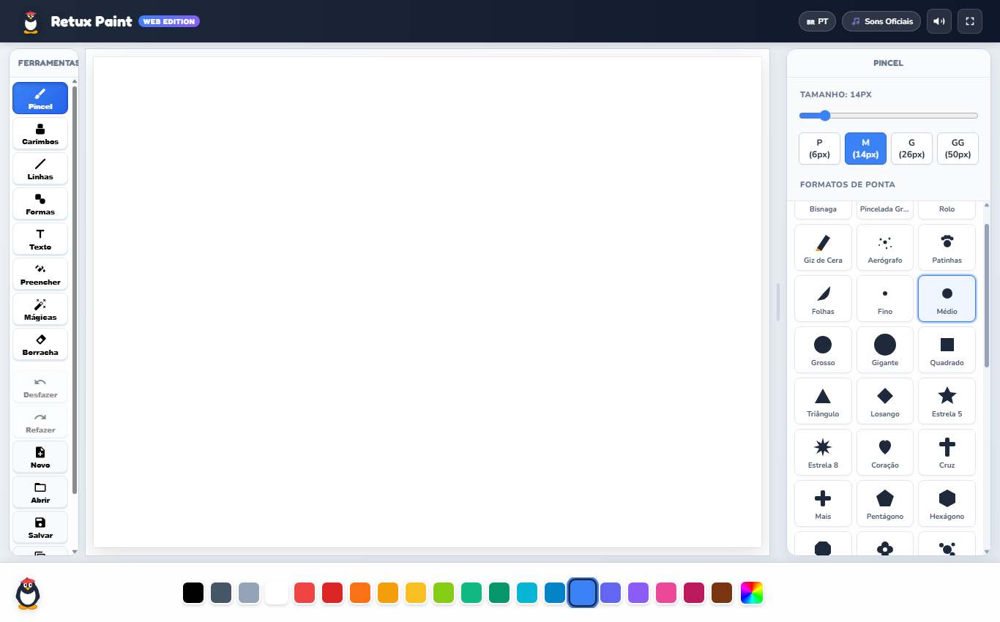
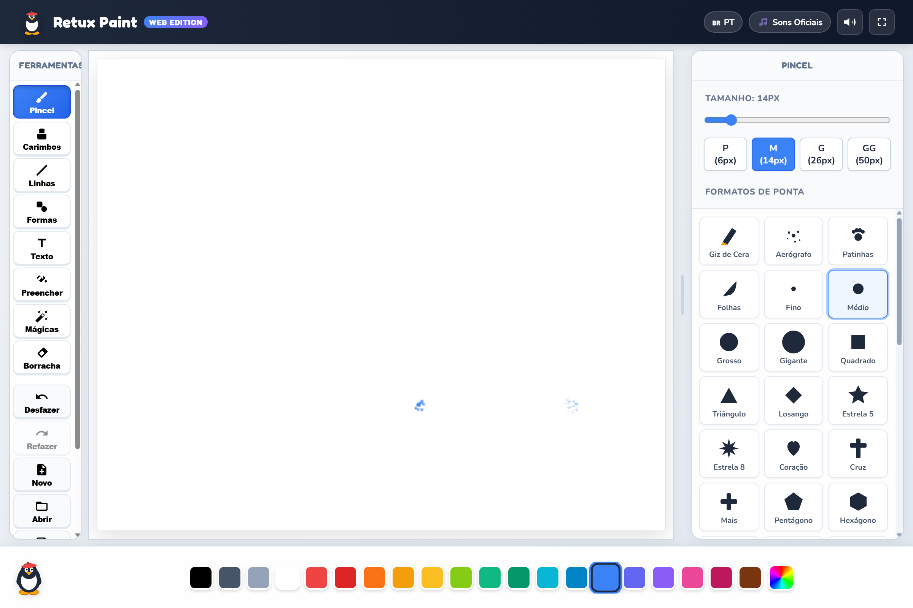
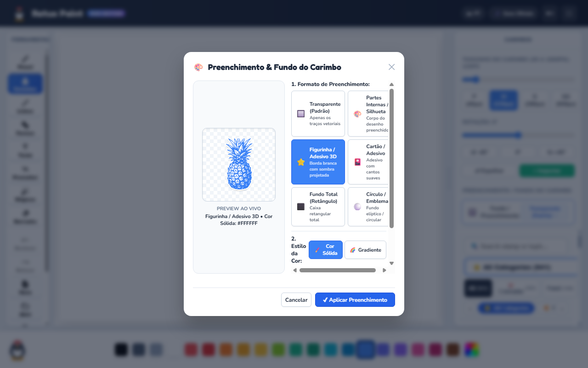
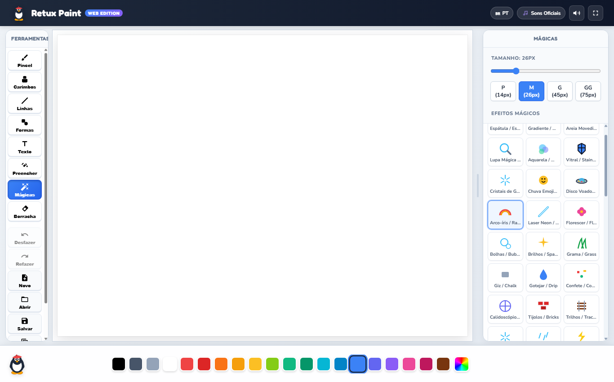
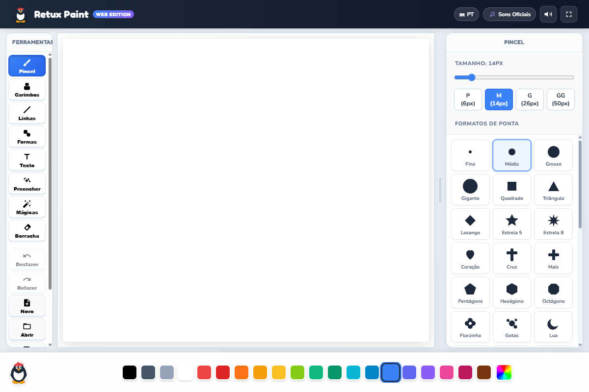
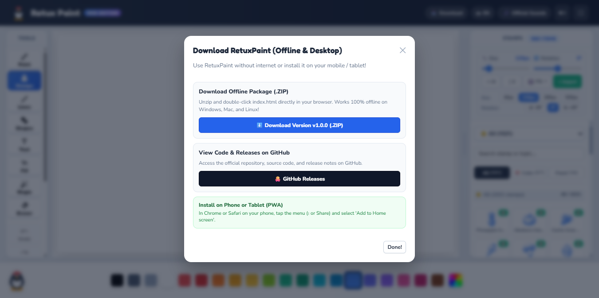

# Retux Paint 🎨🐧

> **Tux Paint Moderno para Web & Android** | **Modern Tux Paint for Web & Android**  
> Desenho e criatividade digital para crianças, educadores e artistas de todas as idades.  
> Digital drawing and creativity for kids, educators, and artists of all ages.

[](https://uzielweb.github.io/retux-paint/)
[](https://github.com/uzielweb/retux-paint/releases/tag/v1.0.6)
[](https://www.gnu.org/licenses/gpl-2.0.html)
[](#)
[-success.svg)](#)



---

## Sumário / Table of Contents
- [🇧🇷 Português](#-português)
  - [Sobre o Projeto](#sobre-o-projeto)
  - [Visão Geral da Interface](#visão-geral-da-interface)
  - [Instruções de Uso (Passo a Passo)](#instruções-de-uso-passo-a-passo)
    - [1. Pincéis e Desenho Livre](#1-pincéis-e-desenho-livre)
    - [2. Carimbos e Customização de Cores](#2-carimbos-e-customização-de-cores)
    - [3. Efeitos Mágicos (61 Efeitos)](#3-efeitos-mágicos-61-efeitos)
    - [4. Ferramenta de Texto](#4-ferramenta-de-texto)
    - [5. Linhas e Formas Geométricas](#5-linhas-e-formas-geométricas)
    - [6. Paleta e Seletor de Cores Mágico](#6-paleta-e-seletor-de-cores-mágico)
    - [7. Gerenciamento de Desenhos (Novo, Abrir, Salvar)](#7-gerenciamento-de-desenhos-novo-abrir-salvar)
    - [8. Áudio e Idioma](#8-áudio-e-idioma)
    - [9. Aplicativo Android (Download e Instalação)](#9-aplicativo-android-download-e-instalação)
  - [Execução Local e Desenvolvimento](#execução-local-e-desenvolvimento)
- [🇺🇸 English](#-english)
  - [About the Project](#about-the-project)
  - [Interface Overview](#interface-overview)
  - [User Guide (Step by Step)](#user-guide-step-by-step)
    - [1. Brushes and Freehand Drawing](#1-brushes-and-freehand-drawing)
    - [2. Stamps and Color Customization](#2-stamps-and-color-customization)
    - [3. Magic Effects (61 Tools)](#3-magic-effects-61-tools)
    - [4. Text Tool](#4-text-tool)
    - [5. Lines and Geometric Shapes](#5-lines-and-geometric-shapes)
    - [6. Palette and Custom Color Picker](#6-palette-and-custom-color-picker)
    - [7. Artwork Management (New, Open, Save)](#7-artwork-management-new-open-save)
    - [8. Audio and Language Settings](#8-audio-and-language-settings)
    - [9. Android App (Download & Installation)](#9-android-app-download--installation)
  - [Local Setup and Development](#local-setup-and-development)
- [Licença / License](#licença--license)

---

## 🇧🇷 Português

### Sobre o Projeto
O **Retux Paint** é uma recriação moderna, elegante e 100% responsiva para a web e dispositivos móveis do clássico e premiado **Tux Paint**. Desenvolvido com tecnologias modernas da Web (HTML5 Canvas 2D, Web Audio API e Vanilla JavaScript), o aplicativo é auto-contido, rápido e roda com performance máxima no desktop, smartphones, tablets e lousas digitais interativas.

---

### Visão Geral da Interface

A interface foi projetada para combinar a nostalgia clássica com a sofisticação das diretrizes modernas de design (cantos retos na folha imitando papel autêntico, menus desobstruídos e suporte completo a telas táteis):

#### Modo Desktop


- **Barra Esquerda (Ferramentas):** Acesso a Pincel, Carimbos, Linhas, Formas, Texto, Preencher, Mágicas, Borracha, Desfazer, Refazer, Novo, Abrir, Salvar e Imprimir.
- **Área Central (Papel de Desenho):** Canvas amplo com proporção perfeita e sombra suave.
- **Barra Direita (Opções):** Exibe dinamicamente os seletores de pincéis, carimbos por categoria, formas ou mágicas da ferramenta ativa.
- **Barra Inferior (Paleta e Tux):** Paleta rápida de cores, seletor de gradiente/espectro e o mascote Tux com dicas de uso.

#### Modo Mobile & Tablets


- **Barra Superior Única:** Todos os botões essenciais organizados de forma compacta (Ferramentas, Desfazer, Refazer, Novo, Salvar, Áudio, Idioma e Opções).
- **Gavetas em Tela Cheia:** Menus abrem em sobreposição total fluida e fecham automaticamente ao selecionar uma opção, garantindo espaço máximo para a pintura.

---

### Instruções de Uso (Passo a Passo)

#### 1. Pincéis e Desenho Livre

1. Clique no botão **Pincel** na barra de ferramentas lateral (ou superior no mobile).
2. No painel de opções à direita, escolha o formato e espessura do traço (pontas circulares, quadradas, estrelas, triângulos ou tubos).
3. Selecione uma cor na paleta inferior.
4. Desenhe livremente na tela. O sistema possui cadência de áudio contínua sem engasgos e resposta de toque imediata.

#### 2. Carimbos e Customização de Cores

1. Clique em **Carimbos**.
2. Navegue pelas categorias (Animais, Dinos, Fofos, Instrumentos, Veículos, Plantas, etc.) através dos botões ou chips deslizantes.
3. Clique sobre o carimbo desejado.
4. Ajuste o tamanho e rotação nos controles inferiores, se desejar.
5. Clique na folha para estampar!

##### Carimbos Coloríveis (Customização com Cores ou Gradientes)

- Carimbos com suporte a cores exibem opções de preenchimento.
- Você pode optar por **Cor Sólida**, **Gradiente Linear** ou **Gradiente Radial**, escolhendo a cor primária e secundária antes de estampar.

#### 3. Efeitos Mágicos (61 Efeitos)

1. Clique em **Mágicas** para abrir o catálogo com mais de 60 efeitos.
2. Escolha o efeito desejado:
   - **Partículas & Natureza:** Florescer, Grama, Hera, Bolhas, Chuva, Neve, Chamas de Fogo, Galáxia.
   - **Filtros Artísticos:** Mosaico, Calidoscópio, Giz, TV Retrô, Pixelizar, Vidro Translúcido, Desfocar, Sépia.
   - **Especiais:** Disco Voador / UFO (desenha naves espaciais com feixe neon de abdução), Tornado, Cristais, etc.
3. Arraste ou clique sobre o desenho para aplicar a mágica em tempo real.

#### 4. Ferramenta de Texto

1. Clique na ferramenta **Texto**.
2. No painel de opções, escolha a família tipográfica e o estilo.
3. Clique em qualquer local da folha para posicionar a caixa de texto interativa.
4. Digite a sua mensagem. Você pode arrastar a alça pontilhada para reposicionar o texto.
5. Clique no botão verde `✓ Pronto!` ou clique fora da caixa para carimbar o texto definitivamente.

#### 5. Linhas e Formas Geométricas (Geometria Contínua e Fases da Lua)
1. Selecione **Linhas** ou **Formas**.
2. **Formas Contínuas em Curvas Suaves:** Nuvem em curvas de Bézier orgânicas únicas (sem círculos cruzados) e Raio em zigue-zague estilizado de traço contínuo único.
3. **Fases Lunares Completas:** Escolha entre **Lua Crescente**, **Lua Minguante** e **Lua Cheia** (com crateras e mares lunares artísticos).
4. **Cor de Contorno Personalizável:** Alterne entre modo Preenchido, Contorno e Ambos, personalizando a **Cor do Contorno** com a mini-paleta de acesso rápido, cor personalizada no seletor ou sincronizando com a paleta principal.
5. Pressione e arraste na tela para definir o tamanho e o ângulo de rotação da forma.
6. Solte o dedo ou o mouse para fixar a geometria.

#### 6. Zoom e Navegação sem Perda de Resolução (Lossless Canvas Zoom)
- **Controles no Cabeçalho (Canvas 100% Livre):** Botões de zoom (`−`, `+`, badge com percentual de 50% a 500% e reset `⛶`) localizados na barra superior (desktop) e na barra de status contextual (mobile), mantendo a área do desenho completamente desobstruída.
- **Ctrl + Roda do Mouse no Desktop:** Aumente ou diminua o zoom com precisão centrado diretamente na posição do cursor do mouse.
- **Shift + Roda ou Alt + Roda do Mouse:** Rolagem / Pan horizontal fluido pelo desenho.
- **Roda do Mouse (Rolagem Livre):** Rolagem vertical suave e navegação bidimensional livre com gestos de trackpad.
- **Gestos de Pinça no Mobile:** Use movimentos naturais de pinça com 2 dedos para aproximar ou afastar o desenho e arrastar o papel sem riscar a tela.
- **Navegação com Teclado (Pan):** Segure a tecla Espaço ou clique com o botão do meio do mouse para navegar livremente pela folha quando aproximada.
- **100% Sem Perda de Conteúdo:** O buffer de pixels nativo é preservado integralmente, permitindo pintar detalhes minuciosos e retornar à visão geral sem nenhuma distorção.

#### 7. Paleta e Seletor de Cores Mágico
- **Paleta Rápida:** Clique em qualquer um dos círculos de cores na base da tela para mudar instantaneamente a cor ativa.
- **Seletor de Cores Mágico:** Clique no botão arco-íris ao final da paleta para abrir o modal avançado:
  - Mapa 2D de Saturação e Brilho.
  - Barra contínua de Matriz (Hue 360°).
  - Campo para digitação de código HEX (#RRGGBB).
  - Amostras de cores pré-definidas.

#### 8. Gerenciamento de Desenhos (Novo, Abrir, Salvar)
- **Novo:** Abre a galeria de papéis de fundo (páginas em branco com cores diversas ou ilustrações para colorir).
- **Salvar:** Salva instantaneamente o seu desenho na galeria local do navegador com miniatura gerada automaticamente e efeito sonoro clássico de câmera.
- **Abrir:** Exibe o carrossel com todas as pinturas salvas, permitindo carregar, continuar pintando, exportar como arquivo PNG ou excluir.
- **Imprimir / Baixar:** Exporta o desenho em alta resolução diretamente para o seu computador ou celular.

#### 9. Áudio e Idioma
- **Controle de Volume Deslizante (0% a 100%):** Ajuste fino do volume geral diretamente no cabeçalho com feedback visual e sonoro.
- **Sons Sintéticos Amplificados:** Ganho sonoro aprimorado dos sintetizadores procedurais Web Audio API, proporcionando presença rica e no mesmo nível dos sons oficiais.
- **Controle de Som de 3 Estados:**
  - 🎵 **Sons Oficiais:** Efeitos originais `.wav` do Tux Paint em alta fidelidade.
  - 🎹 **Sons Sintéticos:** Efeitos retrô gerados via sintetizador Web Audio API.
  - 🔇 **Mudo:** Silêncio para salas de aula e locais silenciosos.
- **Alternador de Idioma (PT / EN):** Alterne entre Português e Inglês com um único clique. Toda a interface, dicas do Tux e nomes das ferramentas são traduzidos instantaneamente.

#### 10. Aplicativo Android (Download e Instalação)

1. No cabeçalho da aplicação web, clique no botão **Baixar App Grátis**.
2. Baixe o instalador oficial **`RetuxPaint-v1.0.6.apk`** diretamente ou através da [página de Releases do GitHub](https://github.com/uzielweb/retux-paint/releases/tag/v1.0.6).
3. No smartphone Android, abra o arquivo baixado. Se solicitado, permita a instalação de fontes confiáveis.
4. Abra o Retux Paint e aproveite a experiência de desenho offline em tela cheia com aceleração gráfica nativa!

---

### Execução Local e Desenvolvimento

Para rodar o projeto localmente em seu computador:

```bash
# 1. Clone o repositório
git clone https://github.com/uzielweb/retux-paint.git
cd retux-paint

# 2. Inicie qualquer servidor HTTP estático (exemplo com Node.js ou Python)
# Opção com Python 3:
python -m http.server 8000

# Opção com Node.js (npx serve):
npx serve .
```

Abra seu navegador em `http://localhost:8000` (ou no seu virtual host local como `http://retuxpaint.local`).

#### Compilação do APK Android (Capacitor & Gradle):
```bash
# Sincronizar assets com a pasta nativa Android
npm run cap:sync

# Compilar o APK de Debug via Gradle
cd android
./gradlew assembleDebug
```
O binário compilado estará em `android/app/build/outputs/apk/debug/app-debug.apk`.

---

## 🇺🇸 English

### About the Project
**Retux Paint** is a modern, responsive web and mobile reimagining of the classic, award-winning **Tux Paint**. Built using modern Web technologies (HTML5 Canvas 2D, Web Audio API, and Vanilla JavaScript), the application is self-contained, lightning-fast, and delivers top-tier performance on desktop browsers, smartphones, tablets, and interactive school whiteboards.

---

### Interface Overview

The interface marries nostalgic charm with modern design principles (crisp straight canvas corners imitating authentic sketch paper, clutter-free controls, and comprehensive touch support):

#### Desktop View


- **Left Sidebar (Tools):** Quick access to Paint, Stamps, Lines, Shapes, Text, Fill, Magic, Eraser, Undo, Redo, New, Open, Save, and Print.
- **Center Canvas:** Generous drawing sheet with realistic proportions and soft depth drop shadow.
- **Right Sidebar (Options):** Dynamically displays brushes, categorized stamps, shapes, or magic effect selectors.
- **Bottom Bar (Palette & Tux):** Fast color palette, spectrum color picker, and Tux the Penguin offering interactive guidance.

#### Mobile & Tablet View


- **Unified Single Header:** Compact top bar housing all primary actions (Tools, Undo, Redo, New, Save, Audio, Language, and Options).
- **Full-Screen Drawers:** Sidebars slide out as smooth full-screen overlays, auto-closing upon tool selection to maximize screen drawing real estate.

---

### User Guide (Step by Step)

#### 1. Brushes and Freehand Drawing

1. Select the **Paint** tool in the tools panel.
2. In the right options drawer, pick a brush shape and size (round, square, stars, triangles, or textured rollers).
3. Choose a color from the bottom palette.
4. Draw smoothly across the canvas. Features continuous cadence audio and zero-latency stroke response.

#### 2. Stamps and Color Customization

1. Click the **Stamps** tool.
2. Browse through stamp categories (Animals, Dinos, Cute, Musical Instruments, Vehicles, Plants, etc.) using category chips.
3. Select any stamp.
4. Adjust scale or rotation in the bottom drawer controls.
5. Tap anywhere on the canvas to place your stamp!

##### Colorable Stamps (Solid & Gradient Fills)

- Stamps marked with colorable properties display custom color fill options.
- Choose between **Solid Color**, **Linear Gradient**, or **Radial Gradient**, picking primary and secondary tones before stamping.

#### 3. Magic Effects (61 Tools)

1. Tap **Magic** to unlock a catalog of 60+ interactive effects.
2. Choose your effect:
   - **Particles & Nature:** Bloom, Grass, Ivy, Bubbles, Rain, Snow, Fire Flames, Galaxy.
   - **Artistic Filters:** Mosaic, Kaleidoscope, Chalk, Retro TV, Pixelize, Frosted Glass, Blur, Sepia.
   - **Special:** Flying Saucer / UFO (paints animated spaceships with abduction neon beams), Tornado, Crystals, and more.
3. Drag or click on the canvas to paint the effects in real time.

#### 4. Text Tool

1. Click the **Text** tool.
2. Pick your desired font family and style in the right drawer.
3. Click anywhere on the drawing canvas to spawn the text box.
4. Type your message. Drag the dotted handle to reposition the text easily.
5. Click the green `✓ Done!` button or click outside to seal the text onto your artwork.

#### 5. Lines and Geometric Shapes (Continuous Outlines & Moon Phases)
1. Select **Lines** or **Shapes**.
2. **Smooth Continuous Outlines:** Organic single-path Cloud geometry (no self-intersecting circles) and clean single-polygon Lightning bolt.
3. **Complete Lunar Phases:** Select between **Waxing Crescent**, **Waning Crescent**, and **Full Moon** (featuring artistic lunar craters and maria).
4. **Customizable Stroke Colors:** Toggle between Filled, Outline, and Both modes, with a dedicated **Stroke Color** mini-palette, custom picker dialog, or palette sync.
5. Click and drag to define scale and angle.
6. Release to render the geometric shape onto the sheet.

#### 6. Lossless Canvas Zoom & Pan
- **Header-Integrated Zoom (100% Canvas Area Free):** Zoom controls (`−`, `+`, percentage badge 50% to 500%, and `⛶` reset) placed cleanly in the top header (desktop) and contextual status bar (mobile), leaving the drawing space completely unobstructed.
- **Desktop Ctrl + Mouse Wheel:** Precision zooming centered directly on your mouse cursor.
- **Shift + Wheel or Alt + Wheel:** Fluid horizontal scrolling and canvas panning.
- **Mouse Wheel (Free Scroll):** Smooth vertical scroll and 2D free panning via trackpad gestures.
- **Mobile Pinch-to-Zoom:** Natural two-finger pinch gesture to zoom in/out and drag paper across the screen without accidental marks.
- **Canvas Panning:** Hold Spacebar or click the middle mouse button to navigate large canvases smoothly.
- **100% Lossless:** Canvas bitmap resolution is preserved without pixelation or redraw loss.

#### 7. Palette and Custom Color Picker
- **Quick Palette:** Tap any color circle at the bottom to switch the active hue.
- **Magic Color Picker:** Tap the rainbow icon at the end of the palette to open the advanced dialog:
  - 2D Saturation and Lightness field.
  - Continuous 360° Hue slider.
  - Direct HEX code input (#RRGGBB).
  - Quick-pick swatch presets.

#### 8. Artwork Management (New, Open, Save)
- **New:** Choose from multiple paper colors or pre-drawn coloring templates.
- **Save:** Saves instantly to the browser's local gallery with an auto-generated thumbnail and camera shutter sound.
- **Open:** View previously saved drawings, reload them, export high-res PNG files, or delete old drafts.
- **Print / Download:** Export high-resolution PNG images directly to your device.

#### 9. Audio and Language Settings
- **Smooth Volume Slider (0% to 100%):** Fine-tune overall audio volume directly from the header with live visual and sound feedback.
- **Boosted Synthetic Audio:** Richer, fuller presence for procedural Web Audio API synthesizers, perfectly balanced with official sounds.
- **3-State Audio System:**
  - 🎵 **Official Sounds:** Original high-fidelity Tux Paint `.wav` audio cues.
  - 🎹 **Synthetic Retro:** Procedural retro synthesizer tones powered by Web Audio API.
  - 🔇 **Mute:** Quiet mode for classrooms, offices, and quiet spaces.
- **Language Switcher (PT / EN):** Switch between Portuguese and English on the fly with a single click.

#### 10. Android App (Download & Installation)

1. Click the **Download App** button on the top web bar.
2. Download the official **`RetuxPaint-v1.0.6.apk`** directly or via the [GitHub Releases page](https://github.com/uzielweb/retux-paint/releases/tag/v1.0.6).
3. Open the APK on your Android device and confirm installation.
4. Launch Retux Paint to enjoy distraction-free, offline full-screen drawing!

---

### Local Setup and Development

To run the project locally on your machine:

```bash
# 1. Clone the repository
git clone https://github.com/uzielweb/retux-paint.git
cd retux-paint

# 2. Start any local web server
python -m http.server 8000
```

Open your browser at `http://localhost:8000`.

#### Build Android APK (Capacitor & Gradle):
```bash
npm run cap:sync
cd android
./gradlew assembleDebug
```
The output APK will be generated at `android/app/build/outputs/apk/debug/app-debug.apk`.

---

## Licença / License
Distributed under the **GNU General Public License v2.0 or later (GPL v2+)**.  
See the `LICENSE` file for more details.  
Tux Paint is a registered trademark of New Breed Software / Bill Kendrick. Retux Paint is an independent, modern web recreation dedicated to the open-source education community.
